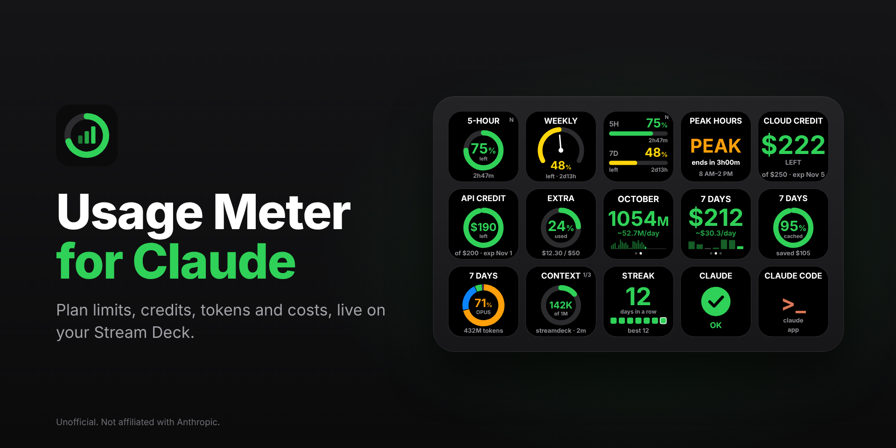
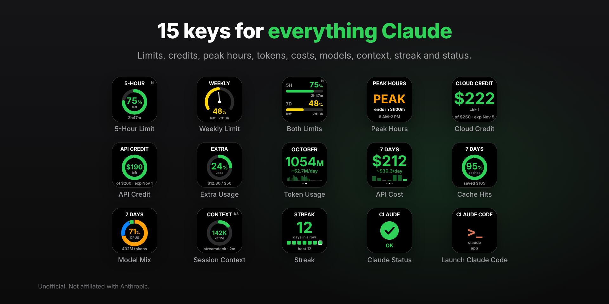
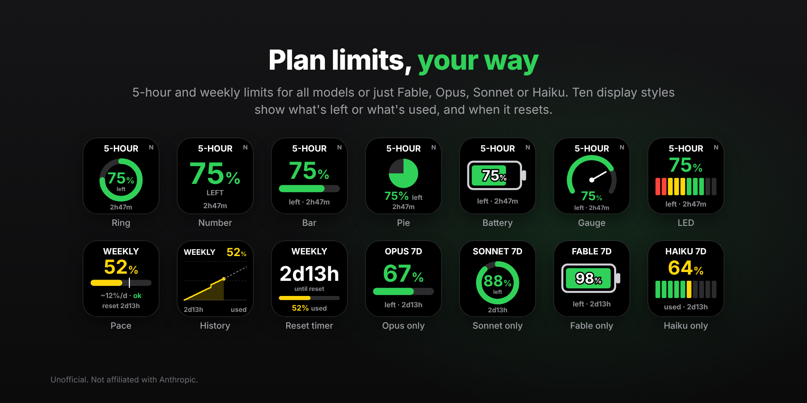
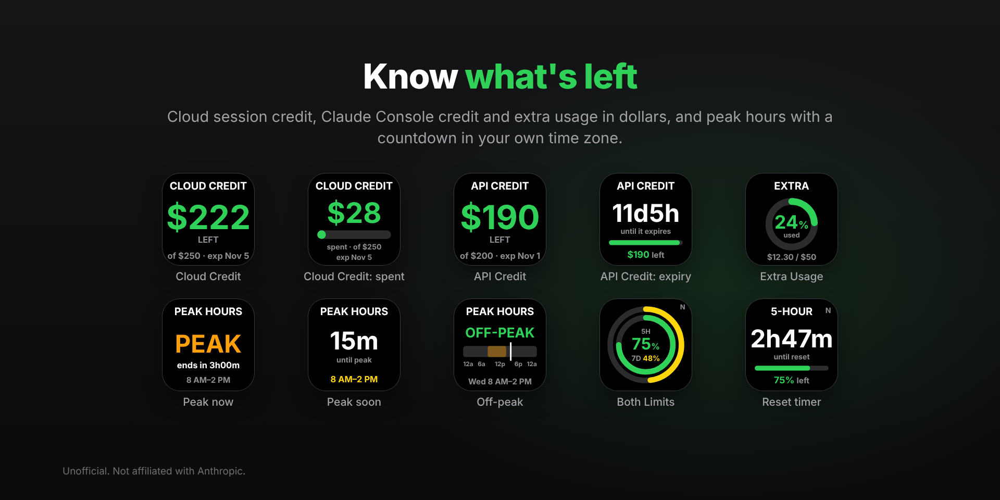
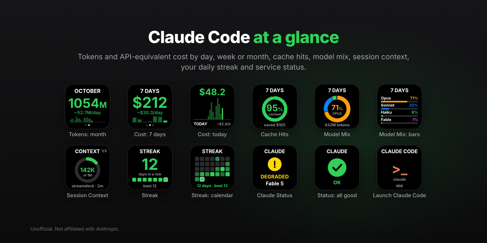

# Usage Meter for Claude

[](https://github.com/developerscompany/usage-meter-for-claude/actions/workflows/ci.yml)
[](https://github.com/developerscompany/usage-meter-for-claude/releases/latest)
[](LICENSE)


Your Claude usage on Stream Deck: plan limits for every model, peak hours, cloud and API credit, the tokens and API-equivalent cost of Claude Code, cache hits, model mix, session context, a daily streak and service status, plus a key that starts Claude Code.

> Unofficial plugin by [Rivo Agency](https://rivo.agency). Not affiliated with or endorsed by Anthropic.



[Українською](README.uk.md)

## Install

1. Download **`agency.rivo.usage-meter-for-claude.streamDeckPlugin`** from the [latest release](https://github.com/developerscompany/usage-meter-for-claude/releases/latest).
2. Double-click it. Stream Deck installs the plugin. Later versions install the same way and keep your keys and their settings.
3. In the action list, open **Usage Meter for Claude** and drag the keys you want onto your Stream Deck. Each key's settings show a live preview of every display style; click one to use it.

**Requirements:** Stream Deck 6.9 or later on macOS 12+ or Windows 10+, and Claude Code signed in on the same computer for the limit and credit keys. The plugin is tested on macOS; Windows support is in the code but hasn't been tried on a real PC yet.

## Keys

| Key | Shows | Press | Hold |
| --- | --- | --- | --- |
| **5-Hour Limit** | the 5-hour session limit: left or used, and the time until it resets | switch left / used (configurable) | refresh |
| **Weekly Limit** | the weekly limit for all models, or just Fable, Opus, Sonnet or Haiku | the same | refresh |
| **Both Limits** | 5-hour and weekly limits on one key | the same | refresh |
| **Peak Hours** | whether it's peak time now (weekdays 5–11 AM Pacific) and when it ends or starts, in your time zone | next style | — |
| **Cloud Credit** | dollars left of your plan's cloud session credit, and when it expires | switch left / spent | refresh |
| **API Credit** | what's left of a Claude Console credit (such as $200 of promotional API credit) after your API spend | switch left / spent | refresh |
| **Extra Usage** | extra usage spent this month, out of your monthly limit | open the usage page | refresh |
| **Token Usage** | Claude Code tokens today, over 7 days or this month | next period | rescan |
| **API Cost** | what that usage would cost at Anthropic's API list prices | next period | rescan |
| **Cache Hits** | the share of input read from the prompt cache, and what it saved | next period | rescan |
| **Model Mix** | the share of Fable, Opus, Sonnet and Haiku | next period | rescan |
| **Session Context** | how full the context of your latest Claude Code sessions is | next session | rescan |
| **Streak** | days in a row with Claude Code | next style | rescan |
| **Claude Status** | service status from status.claude.com, naming the model in trouble (`DEGRADED · Fable 5`) | open the incident or status page | refresh |
| **Launch Claude Code** | opens a terminal running `claude` in a folder you choose, with any of your Claude accounts | launch | — |

Limit keys have ten display styles: ring, number, bar, pie, battery, gauge, LED, pace, history and reset timer. **Pace** shows how fast you're using the limit against an even pace, and warns `limit in 1h12m` when it won't last until the reset. **History** draws your usage over the current window and projects it to the reset. Colours go green, then yellow (from 50% used by default), then red (from 80%); both levels can be changed per key.

| | |
| --- | --- |
|  |  |
|  |  |

## Where the numbers come from

**For your whole account (from Anthropic):** 5-Hour, Weekly and Both Limits, Cloud Credit and Extra Usage. The plugin makes the same request as Claude Code's `/usage` command, `GET https://api.anthropic.com/api/oauth/usage`, with your Claude Code login. These numbers include every computer you use, the Claude apps and cloud sessions.

**For this computer only (from Claude Code's logs):** Token Usage, API Cost, Cache Hits, Model Mix, Session Context and Streak read `~/.claude/projects` and any `~/.claude-*` profile folders. Anthropic doesn't publish token counts per model for Pro and Max accounts, so these can only come from Claude Code itself. Each response is counted once, even when a log repeats it. To include other computers, copy their `~/.claude/projects` into a folder such as `~/.claude-laptop/projects` on this one, for example with [Syncthing](https://syncthing.net); the plugin finds `~/.claude-*` folders by itself. Chats on claude.ai and in the Claude apps never appear here, because their logs aren't on your computer.

**Costs** use Anthropic's API list prices (October 2026), including cache writes and reads, long context, fast mode and web search. They estimate what the same work would cost through the API; they aren't your subscription bill.

**Service status** comes from the public status.claude.com API. When an incident names a model, the key shows it; when it doesn't and only one service is hit, a key that watches all of Claude names that service.

## Setup

### Your Claude Code login

The plugin reads the login Claude Code keeps: on macOS from the Keychain item `Claude Code-credentials`, elsewhere from `~/.claude/.credentials.json`. The first time, macOS may ask whether to allow access to it; choose **Always Allow**.

Logins expire after a while, and only `claude` renews them when it runs, so a computer where you don't use Claude Code for a day (because you work on another one, say) ends up with an expired login. The keys then dim their last numbers and say `login expired` at the bottom. Start `claude` on this computer (or press a **Launch Claude Code** key) and send any message; the keys recover within a minute, or at once if you hold one.

### Several Claude accounts

Each Claude account needs its own Claude Code profile folder:

1. In Terminal, run `CLAUDE_CONFIG_DIR=~/.claude-work claude`. On Windows, in Command Prompt: `set "CLAUDE_CONFIG_DIR=%USERPROFILE%\.claude-work" && claude`.
2. Sign in with the other account when Claude Code asks (or type `/login`).
3. In the key's settings, choose `~/.claude-work` under **Account**. Profiles show up by themselves, with the email signed in to each.

Give each key its own account and a short **Tag** such as `W` to tell them apart. **Auto** always takes the freshest login, so it can't show two accounts side by side. A **Launch Claude Code** key set to the same account opens it in one press, which also keeps that account's login fresh.

The plugin has no "sign in with Claude" of its own: Anthropic offers no sign-in for third-party apps, and the long-lived token from `claude setup-token` can't read usage limits. So the plugin only ever reads the logins Claude Code already has.

### API Credit (Claude Console)

Anthropic has no API for the Console credit balance, so this key takes your API spend since the credit was granted, read with the Usage and Cost Admin API, off the amount granted:

1. In the [Claude Console](https://platform.claude.com/settings/admin-keys), create an Admin key (`sk-ant-admin01-…`).
2. On macOS, store it in the Keychain; paste the key when asked:
   ```sh
   security add-generic-password -a "$USER" -s "Usage Meter for Claude Admin Key" -w
   ```
   On Windows, save it as the only line of `%APPDATA%\agency.rivo.usage-meter-for-claude\admin-key`. The key's settings show the exact path for your computer.
3. In the key's settings, enter the credit's amount and dates from **Billing → Promotional credits**, for example `200`, `2026-10-18` and `2026-11-01` (UTC, as in the Console).

Without an amount, the key shows this month's API spend. An Admin key can administer your organization, so keep it in the Keychain; you can revoke it in the Console at any time.

### Peak hours and clock format

Anthropic introduced peak hours on March 26, 2026: on weekdays from 5 to 11 AM Pacific time, 5-hour session limits run down faster. Since May 6, 2026 this no longer applies to Claude Code on Pro and Max plans. The key works out the schedule itself, US daylight saving time included, and shows it in your time zone. **Warn before** turns it yellow (`SOON`) ahead of time.

Whether times show as 24-hour or AM/PM follows your computer's region, not its language. The Peak Hours key can also be set by hand (**Clock**).

## What the keys say

| Message | Meaning |
| --- | --- |
| `no Claude login / run claude` | no Claude Code login was found for this account |
| `login expired / run claude` | the login expired: run `claude` and send any message |
| `token refused` | Anthropic didn't accept the login; details in the key's settings |
| `rate limited` / `offline` / `API error` | a temporary problem; the plugin retries |
| `not on your plan` | your plan has no such limit (for example, a separate Haiku limit) |
| `only on claude.ai / press to open` | the API didn't send the cloud credit; press to open claude.ai |
| `no Claude Code use` | no requests in this period |
| `no Admin key / see settings` | the API Credit key found no Admin key |
| `key refused / see settings` | the Admin API refused the key: it must be an Admin key of the organization whose credit you track |
| dimmed numbers, `login expired` at the bottom | the last numbers from before the login expired: run `claude` here and send any message |
| dimmed numbers, `3h old` at the bottom | the plugin couldn't update them for that long; the key's settings say why |
| small ring in a corner | the last update failed; the numbers may be a few minutes old |

The plugin's log is in the plugin folder, on macOS `~/Library/Application Support/com.elgato.StreamDeck/Plugins/agency.rivo.usage-meter-for-claude.sdPlugin/logs/plugin.log`.

## Privacy and security

- Everything runs on your computer. There's no analytics, no telemetry and no server of ours.
- The plugin only talks to `api.anthropic.com` (limits, credit and, for API Credit, your organization's cost report) and `status.claude.com`.
- Your Claude Code login and the Admin key are only read: never refreshed, copied, written to a log, shown in settings or sent anywhere but `api.anthropic.com`.
- It keeps the latest numbers and a short history for the History style in its data folder (`~/Library/Application Support/agency.rivo.usage-meter-for-claude` on macOS).

Details: [PRIVACY.md](PRIVACY.md). To report a security problem, see [SECURITY.md](SECURITY.md).

## Development

Needs Node.js 20 or later.

```sh
npm install
npm run build        # src/ → agency.rivo.usage-meter-for-claude.sdPlugin/bin/plugin.js
npm test             # unit tests, the whole plugin against a fake Stream Deck and fake APIs, the settings panel
npm run pack         # validate the manifest and build dist/agency.rivo.usage-meter-for-claude.streamDeckPlugin
npm run icons        # plugin, category and action icons (PNG)
npm run marketplace  # listing images in marketplace/
```

The settings panel tests and the image scripts need [Playwright](https://playwright.dev) with Chromium installed globally (`npm install -g playwright`); without it, those tests are skipped.

| Path | What's inside |
| --- | --- |
| `src/plugin.js` | the core: keys, presses and holds, shared data sources, previews for the settings panel |
| `src/streamdeck.js` | the connection to Stream Deck through Elgato's SDK (`@elgato/streamdeck`) |
| `src/actions/` | the fifteen keys: defaults, drawing, what a press does, data for the settings panel |
| `src/render/` | key images as SVG (SVG Tiny only: Stream Deck draws keys with Qt) |
| `src/usage-index.js` | incremental reading of Claude Code's logs: tokens, cost, models, hours, sessions |
| `src/pricing.js` | Claude model prices |
| `src/limits.js` | plan limits and cloud credit: requests, retries, cache and history |
| `src/console.js` | API spend from the Usage and Cost Admin API, for API Credit |
| `src/login.js` | where Claude Code keeps its logins and which to use (read only) |
| `src/status.js` | service status from status.claude.com, and the model an incident names |
| `src/peak.js` | the peak hours schedule in Pacific time |
| `src/clock.js` | 24-hour or AM/PM, from the key's setting or the computer's region |
| `src/launch.js` | the command that opens a terminal running Claude Code |
| `agency.rivo.usage-meter-for-claude.sdPlugin/ui/` | the settings panel shared by every key |

Contributions are welcome; see [CONTRIBUTING.md](CONTRIBUTING.md).

## License

[MIT](LICENSE) © Rivo Agency.

Claude is a trademark of Anthropic, PBC. Elgato and Stream Deck are trademarks of Corsair Memory, Inc. This project is not affiliated with either company.
