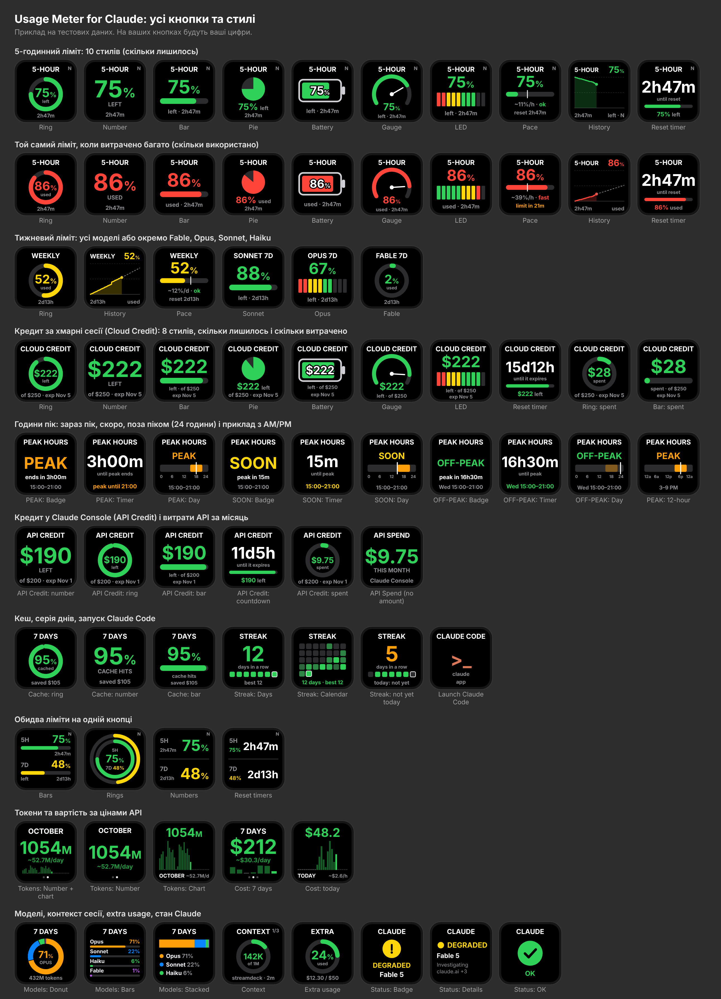

# Usage Meter for Claude

Плагін для Stream Deck від [Rivo Agency](https://rivo.agency). Неофіційний, з Anthropic не пов'язаний. [English](README.md)

Набір кнопок для Stream Deck, який показує все про ваше використання Claude: ліміти плану для кожної моделі, години пік, кредити (за хмарні сесії та в Claude Console), токени й вартість Claude Code, кеш, моделі, контекст сесії, серію днів і стан сервісу. Ще одна кнопка запускає Claude Code.



## Кнопки

| Кнопка | Що показує | Натискання | Утримання |
| --- | --- | --- | --- |
| **5-Hour Limit** | 5-годинний ліміт: скільки лишилось або використано, час до скидання | перемкнути «лишилось / використано» (налаштовується) | оновити |
| **Weekly Limit** | тижневий ліміт: усі моделі або окремо Fable, Opus, Sonnet, Haiku | те саме | оновити |
| **Both Limits** | 5-годинний і тижневий ліміти на одній кнопці | те саме | оновити |
| **Peak Hours** | чи зараз час пік (будні 5–11 ранку за тихоокеанським часом) і коли він закінчиться чи почнеться, за вашим часом | наступний стиль | — |
| **Cloud Credit** | кредит за хмарні сесії Claude Code на вашому плані: скільки доларів лишилось і коли він згорить | перемкнути «лишилось / витрачено» | оновити |
| **API Credit** | кредит у Claude Console (наприклад, промокредит $200 для API): скільки лишилось після витрат API | перемкнути «лишилось / витрачено» | оновити |
| **Extra Usage** | скільки extra usage витрачено цього місяця з ліміту | відкрити сторінку usage на claude.ai | оновити |
| **Token Usage** | токени Claude Code за сьогодні / 7 днів / місяць, у мільйонах | наступний період | пересканувати |
| **API Cost** | скільки це використання коштувало б за цінами API | наступний період | пересканувати |
| **Cache Hits** | яка частка вхідних токенів узята з кешу і скільки це заощадило за цінами API | наступний період | пересканувати |
| **Model Mix** | частка Fable / Opus / Sonnet / Haiku | наступний період | пересканувати |
| **Session Context** | наскільки заповнений контекст останніх сесій Claude Code | наступна сесія | пересканувати |
| **Streak** | скільки днів поспіль ви працюєте з Claude Code | наступний стиль | пересканувати |
| **Claude Status** | стан сервісів зі status.claude.com і модель, з якою проблема (наприклад `DEGRADED · Fable 5`) | відкрити поточний інцидент або сторінку статусу | оновити |
| **Launch Claude Code** | відкриває термінал із `claude` у вибраній папці, з будь-яким вашим акаунтом | запустити | — |

У кнопок лімітів 10 стилів: кільце, число, смуга, пиріг, батарейка, спідометр, LED-шкала, темп, історія і таймер скидання.

- **Темп** показує швидкість витрати (%/год або %/день). Вертикальна мітка на смузі показує, де ви «мали б» бути при рівномірній витраті. Підпис «ok / tight / fast» каже, чи вистачить ліміту до скидання; якщо ні, з'являється «limit in 1h12m».
- **Історія** малює графік витрати за поточне вікно і пунктиром продовжує його до скидання.
- У Both Limits 4 стилі, у Cloud Credit і API Credit по 8 (усі, крім темпу та історії), у Cache Hits 5, у Peak Hours 3 (табличка, таймер, доба), у Streak 2 (дні, календар), у токенів і вартості 3, у моделей 3, у статусу 2.

Колір залежить від витраченого: зелений, потім жовтий (за замовчуванням від 50%), потім червоний (від 80%). Пороги змінюються в налаштуваннях.

## Встановлення

1. Завантажте **`agency.rivo.usage-meter-for-claude.streamDeckPlugin`** з [останнього релізу](https://github.com/developerscompany/usage-meter-for-claude/releases/latest).
2. Двічі клацніть файл. Наступні версії ставляться так само, і вже поставлені кнопки зберігають налаштування.
3. У списку дій виберіть категорію **Usage Meter for Claude** і перетягніть потрібні кнопки. Стиль вибирається в налаштуваннях кнопки: угорі сітка живих прев'ю, досить клацнути потрібне.

Потрібен Stream Deck 6.9 або новіший (macOS 12+ / Windows 10+). Плагін перевірено на macOS; підтримка Windows є в коді, але на справжньому ПК її ще не пробували.

Перехід із Rivo Claude Usage 2.x: з версії 3.0 у плагіна новий UUID (`agency.rivo.usage-meter-for-claude`), тож Stream Deck ставить його як окремий плагін. Кнопки один раз додайте заново з нової категорії, а старий плагін видаліть (правою кнопкою на ньому в списку плагінів → Uninstall). Admin-ключ, уже покладений у зв'язку ключів під старою назвою, плагін і далі знайде.

## Звідки беруться дані

**Ліміти, кредит і extra usage.** Плагін робить той самий запит, що й команда `/usage` у Claude Code: `GET https://api.anthropic.com/api/oauth/usage`. Для цього він читає токен входу Claude Code:

- на macOS — зі зв'язки ключів (`security find-generic-password -s "Claude Code-credentials"`);
- в інших системах — з `~/.claude/.credentials.json`.

Токен лише читається. Плагін його не оновлює, нікуди не записує, не пише в лог і надсилає тільки на `api.anthropic.com`. Під час першого читання macOS може запитати дозвіл на доступ до «Claude Code-credentials»: натисніть «Always Allow» («Дозволяти завжди»).

У режимі **Auto** (за замовчуванням) плагін переглядає всі входи Claude Code на комп'ютері: основний `~/.claude` і кожну папку профілю з логами. З них він бере найсвіжіший. Який вхід знайдено і до якого часу він дійсний, видно в налаштуваннях кнопки в рядку **Login**.

Строк дії токена обмежений, і оновлює його тільки сама програма `claude`, коли надсилає запит. Якщо на цьому комп'ютері день не запускали Claude Code (наприклад, ви працюєте на іншому комп'ютері чи через застосунок Claude), токен спливає. Тоді кнопки блякнуть, а внизу помаранчевим з'являється `login expired`. Запустіть `claude` на цьому комп'ютері (або натисніть **Launch Claude Code**) і надішліть будь-яке повідомлення: за хвилину кнопки оживуть, а якщо затиснути кнопку, то одразу.

Останні значення та історія замірів (для стилю «Історія») зберігаються в `~/Library/Application Support/agency.rivo.usage-meter-for-claude/`.

**Кредит за хмарні сесії.** Кнопка **Cloud Credit** (на ній напис `CLOUD CREDIT`) показує грошовий кредит за хмарні сесії Claude Code: на claude.ai в Settings → Usage він виглядає як «Cloud session credits: $203 of $250 left, Expires November 4». На кнопці — залишок або витрачена сума в доларах, скільки було видано і дата: `exp` — коли кредит згорить, `resets` — коли оновиться. У налаштуванні **Credit** замість нього можна вибрати кредит Claude Code і Cowork. API надсилає його лише у відсотках, тому на кнопці він підписаний `CODE CREDIT`, щоб його не сплутати з грошима.

Важливо: зараз кредит за хмарні сесії Anthropic показує тільки на claude.ai і в застосунку Claude. API, через яке працюють Claude Code і плагін, його не надсилає, тому команда `/usage` у Claude Code його теж не показує. Поки так, кнопка пише `only on claude.ai`, а натискання відкриває сторінку Usage на claude.ai. У Claude Code вже є код для такого кредиту. Коли API почне його надсилати, кнопка сама покаже суму, без оновлення плагіна. Які поля надіслав API, видно в налаштуваннях кнопки в рядку **API fields**.

**Кредит у Claude Console.** Це окремі гроші: кредит організації в Claude Console (platform.claude.com → Settings → Billing), наприклад промокредит $200 для API, Agent SDK, Batch API, Playground і Managed Agents. Хмарні сесії та Claude Code з входом через підписку його не витрачають, лише запити з API-ключами організації. Окремого API для цього балансу Anthropic не має, тож кнопка **API Credit** віднімає від нарахованої суми витрати API з дня нарахування. Витрати вона бере з Usage and Cost Admin API, де вони з'являються приблизно за 5 хвилин. Налаштування:

1. У Claude Console створіть Admin-ключ (Settings → Admin keys). Він має вигляд `sk-ant-admin01-…`.
2. Покладіть його у зв'язку ключів macOS командою в Terminal (ключ вставте, коли спитає; на екрані його не видно):
   `security add-generic-password -a "$USER" -s "Usage Meter for Claude Admin Key" -w`
   Плагін його лише читає і надсилає тільки на `api.anthropic.com`. На Windows ключ кладуть одним рядком у файл `admin-key` у папці даних плагіна (`%APPDATA%\agency.rivo.usage-meter-for-claude`); точний шлях показано в налаштуваннях кнопки.
3. У налаштуваннях кнопки впишіть суму і дати з Billing → Promotional credits: **Credit ($)** `200`, **Granted on** `2026-10-18`, **Expires on** `2026-11-01` (дати в UTC, як у Console).

Без суми кнопка показує витрати API за поточний місяць (`API SPEND`). Admin-ключ дає права адміністратора організації, тож тримайте його лише у зв'язці ключів; відкликати його можна будь-коли в Console.

**Кілька акаунтів.** Кожен акаунт Claude живе у своєму профілі Claude Code, тобто у своїй папці:

1. У Terminal запустіть `CLAUDE_CONFIG_DIR=~/.claude-work claude` (на Windows у Command Prompt: `set "CLAUDE_CONFIG_DIR=%USERPROFILE%\.claude-work" && claude`).
2. Коли Claude Code попросить, увійдіть в інший акаунт (або наберіть `/login`).
3. У налаштуваннях кнопки в полі **Account** виберіть `~/.claude-work`. Профіль з'являється в списку сам, разом з email акаунта, тож видно, де чий.

На кожну кнопку поставте свій акаунт і свою мітку в полі **Tag**, наприклад «N» і «W». Auto завжди бере найсвіжіший вхід, тож для двох акаунтів поруч він не підходить. Ці самі кроки є в налаштуваннях кнопки під полем Account («How to add another Claude account»).

Вхід у профіль лишається свіжим, поки ви ним користуєтесь у Claude Code. Кнопка **Launch Claude Code** з тим самим акаунтом відкриває його одним натисканням. Окремого входу «через Claude» в самому плагіні немає: Anthropic не дає стороннім програмам власного входу в акаунти Claude, а токен, який видає `claude setup-token`, не має доступу до даних про ліміти. Тому плагін бере вхід лише з профілів Claude Code і нічого не зберігає сам.

**Години пік.** Anthropic запровадила їх 26 березня 2026: у будні з 5 до 11 ранку за тихоокеанським часом 5-годинні ліміти сесій витрачаються швидше. З 6 травня 2026 це вже не стосується Claude Code на планах Pro і Max; для чату Claude (сайт, застосунок, телефон) і плану Free про скасування не оголошували. Кнопка **Peak Hours** рахує розклад сама, з урахуванням переходу США на літній і зимовий час, і показує його за вашим часом. У Києві це 15:00–21:00, а в тижні, коли Європа вже перевела годинники, а США ще ні, — 14:00–20:00. Поле **Warn before** заздалегідь фарбує кнопку жовтим («SOON»).

**Формат часу.** 24 години чи AM/PM плагін бере з регіону вашого Mac (System Settings → General → Language & Region), а не з мови: англійська мова з регіоном «Україна» — це 24 години, США — AM/PM. Якщо в macOS примусово ввімкнено 24-годинний час, плагін це врахує. У налаштуваннях Peak Hours формат можна вибрати й вручну (**Clock**).

**Токени, вартість, кеш, моделі, контекст, серія** рахуються за локальними логами Claude Code: `~/.claude/projects/**/*.jsonl` і профілями `~/.claude-*`. Кожна відповідь моделі враховується один раз, повтори склеюються за `message.id`.

**Вартість** рахується за прайсом API Anthropic на жовтень 2026, з урахуванням цін кешу (запис на 5 хвилин ×1,25, на годину ×2, своє читання для кожної моделі), довгого контексту, fast mode і вебпошуку. Це не ваш рахунок за підписку, а оцінка того, скільки те саме коштувало б через API.

**Кеш.** Cache Hits показує, яка частка вхідних токенів (input, запис у кеш і читання з кешу разом) прочитана з кешу, і скільки ці читання заощадили проти повної ціни input за прайсом API. Запис у кеш коштує дорожче (×1,25 або ×2), і тут це не віднімається. Колір: зелений від 70%, жовтий від 40%, нижче — червоний.

**Серія.** Streak рахує дні поспіль, коли Claude Code на цьому комп'ютері зробив хоча б один запит. Поки сьогодні запитів не було, вчорашня серія ще жива і кнопка оранжева; зелена — коли сьогоднішній день уже зараховано. Плагін тримає останні 40 днів, тож довша серія показується як «40+». Стиль «Календар» показує п'ять тижнів: що яскравіша клітинка, то більше запитів того дня.

**Стан сервісу** береться з публічного API status.claude.com. Якщо інцидент стосується конкретної моделі, кнопка її називає: `DEGRADED · Fable 5`. Модель береться з назви інциденту або з останнього оновлення до нього. Якщо модель не названо, кнопка, що стежить за всім Claude, показує уражений сервіс, коли він один. У полі **Watch** можна стежити за всім, за окремим сервісом (Claude Code, claude.ai, API, Console, Cowork) або за сімейством моделей (Fable, Opus, Sonnet, Haiku). У стилі «Details» видно ще, на якому етапі виправлення (Investigating, Identified, Monitoring) і які сервіси зачеплено.

**Не входять у підрахунок токенів:** чати на claude.ai і в застосунку Claude, Claude Code на інших комп'ютерах і в хмарі. У відсотках лімітів вони враховані, бо це дані самої Anthropic. Щоб додати інші комп'ютери, копіюйте їхню папку `~/.claude/projects` у папку на кшталт `~/.claude-laptop/projects` на цьому комп'ютері, наприклад через [Syncthing](https://syncthing.net): папки `~/.claude-*` плагін знаходить сам.

## Запуск Claude Code

Кнопка **Launch Claude Code** відкриває вікно Terminal (або iTerm) і запускає в ньому команду, за замовчуванням `claude`, у вибраній папці. У налаштуваннях: **Folder** (наприклад `~/projects/app`), **Command** (наприклад `claude --continue`), **Account** (з яким акаунтом відкрити Claude Code), **Terminal** і **Tag**. На Windows — Command Prompt або Windows Terminal. Шлях до папки передається окремим аргументом, тож пробіли й лапки в назві нічого не зламають.

## Що означають написи на кнопках

| Напис | Значення |
| --- | --- |
| `no Claude login / run claude` | для цього акаунта не знайдено входу в Claude Code |
| `login expired / run claude` | знайдений вхід сплив: запустіть `claude` і надішліть будь-яке повідомлення |
| `token refused` | Anthropic не прийняла токен; подробиці в налаштуваннях кнопки |
| `rate limited` / `offline` / `API error` | тимчасова проблема, плагін повторить пізніше |
| `not on your plan` | у плану немає такого ліміту (наприклад, окремого Opus чи Haiku) |
| `only on claude.ai / press to open` | API не надіслав кредит; натискання відкриє claude.ai/settings/usage |
| `no Claude Code use` | за цей період у логах немає запитів (Cache Hits) |
| `no Admin key / see settings` | кнопка API Credit не знайшла Admin-ключ (у зв'язці ключів або у файлі `admin-key`) |
| `key refused / see settings` | Admin API не прийняв ключ: потрібен саме Admin-ключ тієї організації, чий кредит показуєте |
| бліді цифри, внизу `login expired` | це останні цифри до того, як вхід сплив: запустіть тут `claude` і надішліть будь-яке повідомлення |
| бліді цифри, внизу `3h old` | плагін стільки часу не міг їх оновити; причина в налаштуваннях кнопки |
| кружечок у куті | останнє оновлення не вдалося; цифрам може бути кілька хвилин |

Лог плагіна на macOS: `~/Library/Application Support/com.elgato.StreamDeck/Plugins/agency.rivo.usage-meter-for-claude.sdPlugin/logs/plugin.log`.

## Розробка

```sh
npm install
npm run build   # src/ → agency.rivo.usage-meter-for-claude.sdPlugin/bin/plugin.js
npm test        # сканер, ціни, ліміти, години пік, формат часу, плагін цілком проти несправжніх Stream Deck і API, панель налаштувань
npm run pack    # перевірка маніфесту і збирання dist/agency.rivo.usage-meter-for-claude.streamDeckPlugin
npm run icons   # іконки плагіна, категорії та дій (PNG)
node scripts/gallery.mjs   # docs/gallery.png з усіма стилями
npm run marketplace        # marketplace/: обкладинка й галерея 1920×960, іконка, тексти для Maker Console
```

Тести панелі налаштувань і скрипти зображень потребують [Playwright](https://playwright.dev) із Chromium, встановленого глобально (`npm install -g playwright`); без нього ці тести пропускаються.

| Файл | Що всередині |
| --- | --- |
| `src/plugin.js` | ядро: кнопки, натискання й утримання, спільні джерела даних, прев'ю для налаштувань |
| `src/streamdeck.js` | зв'язок зі Stream Deck через офіційний SDK Elgato (`@elgato/streamdeck`), якого вимагає DRM на Marketplace |
| `src/actions/` | п'ятнадцять кнопок: налаштування за замовчуванням, малювання, дія на натискання, дані для панелі |
| `src/render/` | SVG-картинки (лише SVG Tiny: Stream Deck малює кнопки через Qt) |
| `src/usage-index.js` | інкрементальне читання логів Claude Code: токени, вартість, моделі, години, сесії |
| `src/pricing.js` | ціни моделей Claude |
| `src/limits.js` | ліміти плану і кредит за хмарні сесії: запит, повтори, кеш та історія |
| `src/console.js` | витрати API з Usage and Cost Admin API для кнопки API Credit (Admin-ключ лише читається) |
| `src/login.js` | де Claude Code зберігає вхід і який зі знайдених узяти (лише читання) |
| `src/peak.js` | розклад годин пік за тихоокеанським часом, з літнім і зимовим часом США |
| `src/clock.js` | 24 години чи AM/PM: з налаштування кнопки або з регіону комп'ютера |
| `src/launch.js` | команда, що відкриває термінал із Claude Code |
| `src/status.js` | стан сервісу зі status.claude.com |
| `agency.rivo.usage-meter-for-claude.sdPlugin/ui/` | спільна панель налаштувань для всіх кнопок |

## Ліцензія

[MIT](LICENSE) © Rivo Agency. Claude — торгова марка Anthropic, PBC. Elgato і Stream Deck — торгові марки Corsair Memory, Inc. Проєкт не пов'язаний із жодною з цих компаній.
